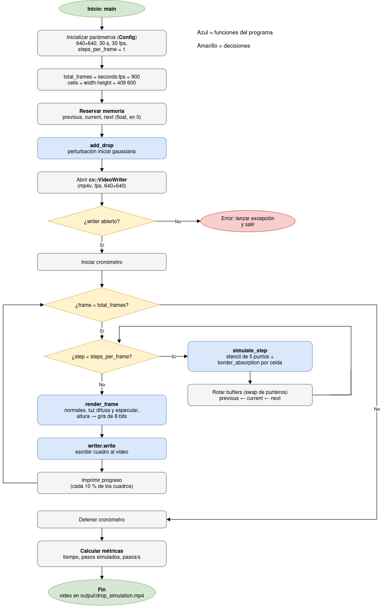

# Laboratorio Semana 9: Ejercicios A y B

**Autor:** Keylor Muñoz  
**Curso:** EL5859 — Computación Heterogénea  
**Periodo:** II Semestre 2026

---

## Ejercicio A. Construcción y ejecución del código base

Se compiló y ejecutó el programa original `drop_simulation` para establecer una línea base de rendimiento antes de realizar optimizaciones. Esta versión implementa la simulación en CPU y no contiene código CUDA, por lo que los resultados de este ejercicio corresponden a la ejecución en CPU.

### Entorno de ejecución

| Componente | Detalle |
|---|---|
| CPU | Intel Core i3-10100F @ 3.60 GHz (turbo de hasta 4.3 GHz), 4 núcleos y 8 hilos |
| Memoria RAM | 15 GiB |
| Sistema operativo | Pop!_OS 24.04 LTS, kernel 7.1.5 |
| Compilador | g++ 13.3.0 |
| Herramientas de construcción | Meson 1.3.2 y Ninja 1.11.1 |
| OpenCV | 4.6.0 |
| Opciones de compilación | `buildtype=release` (`-O3`), C++17 |
| Perfil de energía | `Balanced`; governor `powersave` de `intel_pstate` |
| GPU instalada | NVIDIA GeForce GTX 1650; no utilizada en este ejercicio |

### Comandos ejecutados

```bash
cd drop-simulation
meson setup build
meson compile -C build
./build/drop_simulation

# Cinco corridas para calcular la media y la desviación:
bash scripts/bench_cpu.sh 5
```

### Resultados

| Métrica | Resultado |
|---|---:|
| Compilación | Exitosa, sin errores |
| Tiempo de ejecución (5 corridas) | **15.74 ± 0.17 s** |
| Tiempo mínimo | 15.62 s |
| Tiempo máximo | 16.01 s |
| Pasos simulados por corrida | 900 |
| Rendimiento | **57.2 ± 0.6 pasos/s** |
| Resolución del video | 640 × 640 píxeles |
| Duración del video | 30 s |
| Tasa de cuadros | 30 FPS |
| Archivo generado | `output/drop_simulation.mp4` |
| Datos de las corridas | `results/cpu_baseline.csv` |

La resolución, la tasa de cuadros y la duración se comprobaron con `ffprobe` sobre el video generado. Estos valores coinciden con los parámetros definidos en `Config`.

El video dura 30 segundos, mientras que la simulación tarda aproximadamente 15.74 segundos en generarlo. Por tanto, la ejecución tarda cerca de la mitad del tiempo de reproducción del video. El tiempo medio y la dispersión reportados corresponden a las cinco corridas del script de medición. Estos resultados se utilizarán como referencia para comparar las versiones optimizadas.

> **Nota:** la ejecución inicial también reportó 15.6179 s para una sola corrida. La tabla anterior presenta los resultados agregados de las cinco corridas del script de medición.

---

## Ejercicio B. Comprensión del código

El código fuente comentado se encuentra en `src/cpu/drop_simulation.cpp`. El diagrama de flujo resume las etapas principales del programa.

### ¿Qué hace el programa?

El programa simula la caída de una gota sobre un estanque y guarda el resultado en un video en escala de grises. La superficie del agua se representa mediante una malla de 640 × 640 valores de altura; cada celda corresponde a una posición de la superficie y a un píxel del video.

Al inicio, `add_drop` crea una perturbación en el centro de la malla. En cada paso de simulación, la altura de cada celda se calcula a partir de sus cuatro vecinas y de los valores de altura de los dos instantes anteriores. Así, la perturbación se propaga como ondas por la superficie. El amortiguamiento aumenta cerca de los bordes para reducir los rebotes. Después, `render_frame` convierte las alturas en una imagen y el programa la escribe en el archivo de video. Este proceso se repite hasta completar los 900 cuadros.

### Modelo físico

La simulación aproxima la **ecuación de onda bidimensional amortiguada**:

```text
∂²h/∂t² = c² · ∇²h − γ · ∂h/∂t
```

Donde:

- `h(x, y, t)` representa la altura de la superficie en una posición y un instante.
- `c² · ∇²h` representa la propagación de las ondas a través de la superficie.
- `γ · ∂h/∂t` representa el amortiguamiento, que reduce el movimiento con el tiempo.

La ecuación se resuelve mediante **diferencias finitas explícitas**. Para calcular la altura siguiente, el programa utiliza los estados anterior y actual, además de las cuatro celdas vecinas:

```text
siguiente = 2 · actual − anterior
            + c² · (izquierda + derecha + arriba + abajo − 4 · actual)
            − amortiguamiento_local · (actual − anterior)
```

La velocidad de onda configurada es `0.45` celdas por paso. Este valor está por debajo del límite aproximado de `0.707` indicado para la condición de estabilidad de este esquema en dos dimensiones.

### Funciones principales

| Elemento | Función |
|---|---|
| `Config` | Agrupa los parámetros de la malla, el video, la velocidad de onda, el amortiguamiento y la gota inicial. |
| `index_of` | Convierte las coordenadas `(x, y)` en el índice correspondiente dentro del vector que almacena la malla. |
| `add_drop` | Crea la perturbación inicial en el centro de la superficie. |
| `border_absorption` | Aumenta el amortiguamiento cerca de los bordes para reducir el rebote de las ondas. |
| `simulate_step` | Calcula las nuevas alturas de la malla mediante la ecuación de onda amortiguada. |
| `render_frame` | Convierte la malla en una imagen en escala de grises y añade el número del cuadro. |
| `main` | Inicializa los datos, ejecuta los ciclos de simulación, genera el video y calcula las métricas finales. |

### Diagrama de flujo




El programa inicializa los parámetros, reserva las tres mallas (`previous`, `current` y `next`), aplica la perturbación inicial y abre el archivo de video. Luego recorre los cuadros y ejecuta los pasos de simulación correspondientes. En cada paso se actualiza la malla y se intercambian los buffers mediante `swap`, evitando copiar todo su contenido. Después se renderiza y se escribe el cuadro. Al terminar los 900 cuadros, el programa detiene el cronómetro y muestra el tiempo de ejecución, los pasos simulados y el rendimiento.

### Observaciones para las siguientes etapas

A partir de la lectura del código, se identifican estos aspectos para analizar en las siguientes etapas:

- Con `steps_per_frame = 1`, se genera un cuadro de video por cada paso de simulación.
- `simulate_step` y `render_frame` recorren la malla o la imagen y son candidatas a paralelizarse en la GPU.
- La escritura del video mediante `writer.write` permanece en CPU, por lo que su costo debe tenerse en cuenta al evaluar la mejora total.
- Estas observaciones se deben contrastar con las mediciones y el perfilado de las siguientes etapas.

---

## Optimización 1. Reducir la comunicación host-device

Las mediciones de esta sección se hicieron en la misma máquina que la GPU v0 (Intel Core i5-12400F y NVIDIA GeForce RTX 4060 Ti), para comparar contra la v0 en igualdad de condiciones.


En la v0 las copias por PCIe ocupaban ~42 % del tiempo total. La v1 (`src/gpu/v1_reduced_transfers/`) deja las mallas en la GPU toda la ejecución.

| Aspecto | v0 | v1 |
|---|---|---|
| Mallas | Viven en el host, se copian en cada paso | Viven en la GPU |
| H2D por cuadro | `previous`, `current` y `height` (3 × 1.56 MiB) | Ninguna, solo una copia inicial |
| D2H por cuadro | `next` e imagen (1.56 + 1.17 MiB) | Solo la imagen (1.17 MiB) |
| Rotación de mallas | `swap` de vectores en el host | `std::swap` de punteros en el device |
| Buffers GPU | 5 (incluye `height`) | 4 (render lee `d_current`) |

**GPU v1** (`./build/drop_simulation_gpu_v1`, 900 pasos)

| Corrida | Tiempo (s) | Pasos/s |
|---|---|---|
| 1 | 1.3275 | 677.96 |
| 2 | 1.3025 | 690.99 |
| 3 | 1.3341 | 674.59 |
| **Promedio** | **1.321** | **681.18** |

**Desglose v0 vs v1** (promedio, `cudaEvent`)

| Parte | v0 (ms) | v1 (ms) | v1 % del total |
|---|---|---|---|
| Kernel `simulate_step` | 37.17 | 50.86 | 3.8 % |
| Kernel `render` | 38.09 | 14.43 | 1.1 % |
| Copias H2D | 592.41 | 0.61 | 0.05 % |
| Copias D2H | 428.07 | 199.29 | 15.1 % |
| `putText` + video (CPU) | 1037.14 | 947.41 | 71.7 % |
| Resto | ~277.6 | ~108.8 | ~8.2 % |

**Volumen transferido** (900 cuadros)

| Operación | v0 (MiB) | v1 (MiB) | Reducción |
|---|---|---|---|
| Host-to-Device | 4218.75 | 3.125 | 99.9 % |
| Device-to-Host | 2460.94 | 1054.69 | 57.1 % |
| **Total** | **6679.69** | **1057.81** | **84.2 %** |

**Resumen**

| Versión | Tiempo (s) | Pasos/s | Speedup vs CPU | Speedup vs v0 |
|---|---|---|---|---|
| CPU base | 12.963 | 69.43 | 1.00x | — |
| GPU v0 | 2.411 | 373.52 | 5.38x | 1.00x |
| GPU v1 | 1.321 | 681.18 | **9.81x** | **1.82x** |

El tiempo en copias baja de 1020 ms a 200 ms y la v1 es 1.82 veces más rápida que la v0. Ahora el cuello de botella es `putText` y la escritura del video en CPU, que ocupan ~72 % del total.

### Perfilado nsys v1

```bash
~/micromamba/envs/nsys/bin/nsys profile -f true -o profiling/gpu/v1/v1 --stats=true ./build/drop_simulation_gpu_v1
```

**Copias v0 vs v1 (`cuda_gpu_mem_time_sum`)**

| Operación | v0 (ms) | v1 (ms) | v0 copias | v1 copias | v0 (MB) | v1 (MB) |
|---|---|---|---|---|---|---|
| Host-to-Device | 379.72 | 0.25 | 2700 | 2 | 4423.68 | 3.28 |
| Device-to-Host | 210.07 | 84.31 | 1800 | 900 | 2580.48 | 1105.92 |
| **Total** | **589.79** | **84.57** | **4500** | **902** | **7004.16** | **1109.20** |

**Kernels v0 vs v1 (`cuda_gpu_kern_sum`)**

| Kernel | v0 promedio (µs) | v1 promedio (µs) | v0 total (ms) | v1 total (ms) |
|---|---|---|---|---|
| `render_kernel` | 9.68 | 8.96 | 8.715 | 8.060 |
| `simulate_step_kernel` | 5.89 | 5.71 | 5.298 | 5.139 |
| **Total kernels** | | | **14.013** | **13.199** |

**API de CUDA v0 vs v1 (`cuda_api_sum`)**

| Función | v0 (ms) | v1 (ms) | v0 llamadas | v1 llamadas |
|---|---|---|---|---|
| `cudaMemcpy` | 937.14 | 212.66 | 4500 | 902 |
| `cudaEventSynchronize` | 294.74 | 96.58 | 5400 | 2701 |
| `cudaMalloc` | 129.77 | 130.48 | 5 | 4 |
| `cudaEventRecord` | 101.27 | 51.81 | 10800 | 5402 |
| `cudaLaunchKernel` | 44.00 | 33.97 | 1800 | 1800 |

El tiempo de copias en la GPU baja de 589.8 ms a 84.6 ms, unas 7 veces menos, y el número de copias pasa de 4500 a 902. Los kernels no cambian, porque el código de los kernels es el mismo que en la v0.

`cudaMemcpy` todavía tarda 212.7 ms en el host aunque la copia en la GPU dura solo 84.3 ms. La diferencia viene de usar memoria paginable, que obliga a pasar por un buffer intermedio. Usar memoria pinned (`cudaMallocHost`) para la imagen podría reducir ese tiempo.

### Validación v1 vs CPU

Se ejecutó `./build/drop_simulation_gpu_v1 --validate`. En este modo la malla se baja al host en cada cuadro solo para comparar, fuera de los tiempos de la versión.

| Métrica | v0 | v1 |
|---|---|---|
| Error abs. máximo malla | 6.580e-05 | 6.580e-05 |
| Error abs. medio malla | 1.762e-06 | 1.762e-06 |
| Dif. máxima de píxel | 1 nivel de gris | 1 nivel de gris |
| Píxeles distintos | 61 329 (0.017 %) | 61 329 (0.017 %) |

`validation/v1_errors.csv` es idéntico byte a byte a `validation/v0_errors.csv`. Era lo esperado, porque los kernels son los mismos y solo cambió dónde viven los datos.
